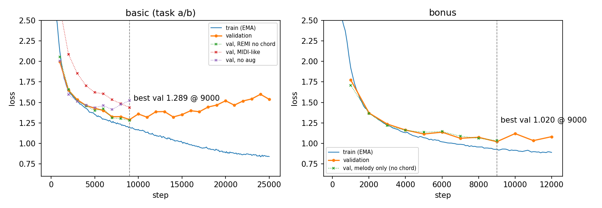
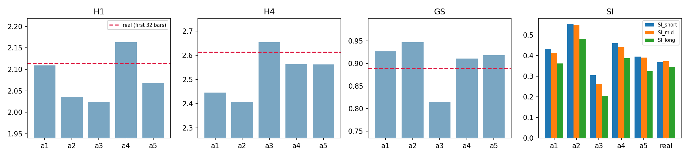

# HW2 – Symbolic Music Generation

**程式碼（GitHub）：https://github.com/hgtffue/Deep-Learning-for-Music-Analysis-and-Generation-HW2**

**模型與生成結果（雲端硬碟）：https://drive.google.com/drive/folders/1DtMPrHbmGz7sVhg6q9yqqLGSFMj-gofX**

## 0. 程式與輸出結構

```
code/music_tok.py   tokenization（REMI + chord + tempo/meter），以及 token → MIDI 解碼
code/train.py       GPT-2 訓練（basic / bonus 共用）
code/generate.py    推論：uncond（task a）、continue（task b）、bonus（伴奏）
code/render.py      FluidSynth + FluidR3_GM.sf2 轉 .wav
code/summarize.py   對 task a 各組設定跑 eval_basic.py 並彙整表格
code/si_eval.py     task a 的 SI（MusDr scape plot）計算
code/midilike.py    MIDI-like 表示法（ablation 用）
code/ablation.py    ablation 訓練 / 生成 / 評估流程（ablation_gen.py 為其生成程式）
code/analysis.py    memorization、task b 一致性分析、圖表
code/make_submission.py  整理上傳雲端硬碟的檔案
code/download.py    用 gdown 從雲端硬碟下載 checkpoints/、tools/
code/demo.py        下載（若缺）＋三個任務的簡單推論，輸出試聽樣本
prompts/            作業提供的 task b / bonus prompt
code/pipeline.py    依序執行所有生成 / 訓練 / 評估
requirements.txt    所有使用到的套件（含版本）
outputs/task_a/<config>/   每組 20 首 32 小節 .mid（+ tokens.json, metrics.csv）
outputs/task_b/<config>/   3 個 prompt 各自的 8+24 小節 .mid + .wav
outputs/bonus/<config>/    10 首 16 小節 MELODY+PIANO .mid + .wav + metrics.csv
outputs/ablation/<name>/   ablation 生成結果
results/                   各項指標彙整（csv）
figs/                      報告圖表
```

**推論方式**（完整說明見 `README.md`）：clone GitHub repo，`pip install -r requirements.txt` 後在 `code/` 執行
```
python download.py                  # gdown 下載 checkpoints/、tools/ 到 repo 根目錄
python demo.py --out <輸出資料夾>     # 一鍵產生 task a / b / bonus 試聽樣本（.mid + .wav）
```
或分別執行（`--prompt_dir` 省略時使用 repo 內的 `prompts/`）：
```
python generate.py uncond   --ckpt ../checkpoints/basic_loss0.9 --out <輸出資料夾> --n 20 --temp 1.0 --top_p 0.95 --wav
python generate.py continue --ckpt ../checkpoints/basic_loss1.2 --out <輸出資料夾> --temp 1.0 --top_p 0.95 --wav
python generate.py bonus    --ckpt ../checkpoints/bonus --out <輸出資料夾> --temp 0.8 --top_k 10 --wav
```
`--out` 指定輸出路徑，`--wav` 會同時用 FluidSynth + FluidR3_GM.sf2 輸出試聽用的 .wav。需要 CUDA GPU。

## 1. Token Representation

採用 **REMI 風格**的單一序列表示，並加入和弦與速度資訊（**w/ Chord**）：

```
<BOS> Bar TS_4 Tempo_90 Pos_0 Chord_B_maj Pitch_47 Vel_65 Dur_6 Pitch_75 Vel_121 Dur_2 Pos_1 Pitch_54 Vel_49 Dur_5 ... Bar TS_4 Tempo_90 ...
```

| Token 類別 | 數量 | 說明 |
|---|---|---|
| `<PAD> <BOS> <EOS>` | 3 | 特殊 token |
| `Bar` | 1 | 小節開頭 |
| `TS_1..8` | 8 | 該小節的拍數（POP909 有 4 拍與 6 拍的曲子） |
| `Tempo_30..210` | 37 | 每小節速度，以 5 BPM 量化 |
| `Pos_0..31` | 32 | 小節內位置，16 分音符格（每拍 4 格） |
| `Chord_<root>_<quality>` + `Chord_N` | 181 | 12 根音 × 15 種和弦性質，轉位省略 |
| `Pitch_21..108` | 88 | 音高 |
| `Vel_1..125` | 32 | 力度，以 4 量化 |
| `Dur_1..64` | 64 | 時值（16 分音符為單位，最長 4 小節） |
| `Track_Mel / Track_Pno` | 2 | 只在 bonus 使用 |
| **合計** | **448** | |

重點：
- **時間格線使用 `beat_midi.txt` 的人工標註拍點**，而非 MIDI 內的 tempo（POP909 MIDI tempo 固定為 120）。音符起點先換算成「連續拍數」再四捨五入到 16 分音符格，因此可以去除演奏的速度起伏。每小節的速度由該小節的拍點間距算出，以 `Tempo_x` token 表示。
- 和弦取自 `chord_midi.txt`，只在和弦改變時於對應位置插入 `Chord_*` token。
- Basic task 把 MELODY / BRIDGE / PIANO 三軌合併。每首歌從第一個有音符的小節開始。
- `Pos_*` 與 `Pitch_*` 的 id 皆為連續，符合 MusDr（`eval_basic.py`）的假設。
- 平均序列長度約 6,049 tokens/首（約 60 tokens/小節）；32 小節約 2,000–3,500 tokens。

## 2. Model Architecture

Hugging Face `GPT2LMHeadModel`（decoder-only Transformer），從頭訓練：

| 參數 | 值 |
|---|---|
| layers / heads / d_model | 8 / 8 / 512 |
| context length | 1536 |
| 參數量 | 26.2M |
| dropout | 0.1 |

## 3. Implementation Details

- **資料增強**：每個訓練樣本隨機移調 −6 ~ +6 半音（Pitch 與 Chord 根音同步移動，若超出音域則重新抽）。
- **取樣方式**：依歌曲長度加權隨機選曲，從隨機的 `Bar` token 開始切 1536 個 token（10% 機率從 `<BOS>` 開始）。若碰到歌曲結尾則補 `<EOS>` 與 padding（loss 忽略）。
- **最佳化**：AdamW（lr 4e-4、betas (0.9, 0.95)、weight decay 0.01），1000 步 warmup + cosine decay，batch size 8，grad clip 1.0，bf16 autocast。
- **訓練步數**：basic 25,000 步（約 1.8 小時，RTX 5060 8GB）；bonus 12,000 步。
- **驗證**：保留 16 首歌只用來監控 validation loss，其餘 880 首用於訓練。
- 訓練中在 train loss 首次低於 1.2 與 0.9 時各存一份 checkpoint，以比較「不同 loss 的模型」。

Basic 模型 loss 曲線（摘要）：

| step | 1k | 3k | 5k | 7k | 9k | 13k | 17k | 21k | 25k |
|---|---|---|---|---|---|---|---|---|---|
| train | 2.13 | 1.51 | 1.35 | 1.25 | 1.20 | 1.07 | 0.95 | 0.88 | 0.84 |
| val | 2.00 | 1.53 | 1.43 | 1.33 | **1.29** | 1.39 | 1.39 | 1.47 | 1.54 |

validation loss 在約 9k 步最低，之後開始 overfit。



（虛線為第 7 節 ablation 模型的 validation loss。）

### 推論（Inference）

- 自回歸取樣，搭配 KV cache；當長度超過 context 時，保留最後約 768 個 token（從 `Bar` 對齊處開始）作為新 context，重新計算 cache。
- **文法限制（constrained decoding）**：`Pitch` 後只能接 `Vel`、`Vel` 後只能接 `Dur`、`Bar → TS → Tempo` 依序出現、`Pos` 後必須接音符（或和弦）。同一小節內 `Pos` 必須遞增，且不能超出該小節拍數。這只排除不合法的序列，不影響音樂內容。
- 32 小節的終止條件：當模型要開第 33 個 `Bar` 時停止；未滿 32 小節前禁止 `<EOS>`。

## 4. Basic Task a – Unconditional Generation（每組 20 首、32 小節）

| Config | Model | Representation | w/ Chord | Loss (train) | Top-K | Top-p | Temperature | H1 | **H4** | **GS** | SI_short | SI_mid | SI_long |
|---|---|---|:-:|---|---|---|---|---|---|---|---|---|---|
| a1 | GPT-2 | REMI | O | 1.20 (best val) | – | 0.95 | 1.0 | 2.1093 | 2.4458 | 0.9268 | 0.4335 | 0.4116 | 0.3613 |
| a2 | GPT-2 | REMI | O | 1.20 (best val) | 10 | – | 0.8 | 2.0358 | 2.4061 | 0.9468 | 0.5529 | 0.5487 | 0.4808 |
| a3 | GPT-2 | REMI | O | 1.20 (best val) | – | – | 1.2 | 2.0237 | 2.6536 | 0.8145 | 0.3041 | 0.2633 | 0.2041 |
| **a4** | GPT-2 | REMI | O | 0.90 | – | 0.95 | 1.0 | 2.1631 | 2.5637 | 0.9107 | 0.4593 | 0.4407 | 0.3869 |
| a5 | GPT-2 | REMI | O | 0.84 (final) | – | 0.95 | 1.0 | 2.0683 | 2.5615 | 0.9183 | 0.3943 | 0.3899 | 0.3242 |
| Real data (前 32 小節) | | | | | | | | 2.1137 | 2.6133 | 0.8894 | 0.3672 | 0.3733 | 0.3448 |
| Real data (整首) | | | | | | | | 2.1291 | 2.6322 | 0.8807 | – | – | – |

（Real data 用的是同一套 tokenization。由於生成的都是 32 小節，主要比較對象是「前 32 小節」。）

SI（Structureness Indicator，MusDr）：所有 .mid 都用同一個 renderer（pretty_midi + FluidSynth + FluidR3_GM.sf2）轉成音訊，再算 SSM 與 fitness scape plot。SI_short / mid / long 分別是 3–8 秒、8–15 秒、>15 秒時間尺度內 fitness 的最大值。Real data 是從訓練集隨機抽 20 首（seed 0）的前 32 小節，用同一套流程計算（`code/si_eval.py`，逐首結果在 `results/si/si_per_piece.csv`）。

觀察：
- **溫度 / 取樣範圍**：較保守的取樣（a2：T=0.8, top-k 10）讓 H4 偏低、GS 偏高，代表音高集中、節奏過度重複。提高溫度並使用完整分布（a3：T=1.2）讓 H4 最接近真實資料，但 GS 明顯下降（0.81），代表節奏較不穩定。T=1.0 + top-p 0.95 介於兩者之間。
- **模型 loss**：相同取樣設定下（a1/a4/a5），train loss 較低的模型（0.90、0.84）在 H4 上更接近真實資料，GS 也略為下降、更接近真實值。雖然 validation loss 在 9k 步之後上升，生成結果的統計特性反而更像訓練資料（可能是記憶訓練資料所致）。
- **SI（結構性）**：保守取樣的 a2 SI 最高（0.55 / 0.55 / 0.48），遠高於真實資料（0.37 / 0.37 / 0.34）。這不代表結構較好，而是反映它重複同一段素材（與 GS 偏高、H4 偏低一致，也有少數樣本退化成密集重複音）。a3（T=1.2）SI 最低（0.30 / 0.26 / 0.20），長時間尺度幾乎沒有重複結構。T=1.0 + top-p 0.95 的 a1/a4/a5 最接近真實資料，其中 a5 的 short/mid/long 與真實值差距最小，a4 稍高但仍接近。
- **取樣變異**：每組只有 20 首，指標本身的抽樣誤差不小。95% 信賴區間大約是 H1 ±0.07–0.15、H4 ±0.04–0.16、GS ±0.02，詳見下表。例如第 7 節的 `base`（step 9000 的 best-val checkpoint）與 a1（step 8855 的 loss_1.2 checkpoint）幾乎是同一個模型、取樣設定也相同，H1 卻分別是 2.22 與 2.11。因此差距在 ~0.1 以內的 H1/H4 不宜過度解讀；溫度造成的 GS 差異（a2 0.947 vs a3 0.815）則遠超過誤差。

| 95% CI（20 首） | a1 | a2 | a3 | a4 | a5 |
|---|---|---|---|---|---|
| H1 | 2.109±0.123 | 2.036±0.152 | 2.024±0.093 | 2.163±0.073 | 2.068±0.089 |
| H4 | 2.446±0.146 | 2.406±0.162 | 2.654±0.071 | 2.564±0.038 | 2.561±0.076 |
| GS | 0.927±0.024 | 0.947±0.018 | 0.815±0.018 | 0.911±0.018 | 0.918±0.022 |

- 綜合 H1/H4/GS 與真實資料的距離，**a4 最接近**，作為 listening samples（`outputs/task_a/a4_loss0.9_t1.0_p0.95/*.wav`，a1 也已轉成 wav）。



### 4.1 是否在抄訓練資料？（memorization 分析）

a4/a5 使用的是 overfit 之後的 checkpoint，因此檢查生成曲是否直接複製訓練資料（`code/analysis.py`，結果在 `results/memorization.csv`）：
- 把每首曲子的音符依（onset, pitch）排序，轉成 (Δonset, Δpitch) 序列，所以移調後仍視為相同。
- 統計生成曲的 n-gram 有多少比例在 880 首訓練曲中出現過。「all」是三軌合併的所有音符；「mel」是 skyline，也就是每個 onset 取最高音，約略等於主旋律。
- 只有 1 種或少數幾種步伐重複的 n-gram（例如同一個音一直重複）不計入。
- 對照組是 16 首沒用於訓練的真實歌曲的前 32 小節。

| | all 10-gram 重複率 | all 最長重複（音數，平均 / 最大） | mel 8-gram 重複率 | mel 最長重複（平均 / 最大） |
|---|---|---|---|---|
| a1（loss 1.20） | 0.4% | 5.7 / 20 | 0.0% | 1.2 / 8 |
| a2（T=0.8, k=10） | 0.5% | 4.5 / 14 | 0.1% | 1.2 / 8 |
| a3（T=1.2） | 0.0% | 0 / 0 | 0.0% | 0 / 0 |
| a4（loss 0.90） | 0.9% | 9.6 / 39 | 0.2% | 3.3 / 9 |
| a5（loss 0.84） | 1.2% | 8.8 / 15 | 0.6% | 1.3 / 10 |
| 真實歌曲（未見過） | 0.1% | 2.6 / 11 | 0.2% | 2.0 / 8 |

- 20-gram 以上（約一小節以上的完整織體）的重複率在所有設定下都是 0%。主旋律最長的重複片段也只有 8–10 個音，與沒見過的真實歌曲相當，**沒有整段抄襲訓練資料**。
- 但 overfit 越嚴重，短片段的重複率越高（a1 0.4% → a4 0.9% → a5 1.2%）。a4 最長有一段 39 個音（約兩小節的伴奏）與訓練資料相同。所以 a4/a5 的統計特性更接近真實資料，確實有一小部分來自記憶，但影響有限。

## 5. Basic Task b – Prompt Continuation（8 + 24 小節）

使用 task a 的 checkpoint（train loss 1.20，step 8855，接近 validation loss 最低點），不重新訓練。選它而不是 task a 表現最好的 loss 0.90 checkpoint，是因為 prompt 來自模型沒看過的歌曲，續寫更需要泛化能力；loss 0.90 的模型（step 19251）已經明顯 overfit（val loss 約 1.47，最低點是 1.29）。將 prompt 用相同方式 tokenize（同樣使用 prompt 提供的 `beat_midi.txt` / `chord_midi.txt`），以此為前綴續寫，直到總共 32 小節。

| Config | Model | Representation | Checkpoint | Temperature | Top-K | Top-p |
|---|---|---|---|---|---|---|
| b1 | GPT-2 | REMI + Chord | loss 1.20 | 1.0 | – | 0.95 |
| b2 | GPT-2 | REMI + Chord | loss 1.20 | 0.8 | 10 | – |
| b3 | GPT-2 | REMI + Chord | loss 1.20 | 1.2 | – | 0.98 |

輸出：`outputs/task_b/<config>/{001,002,003}.mid/.wav`

Prompt 內容：001 是 G 小調，只有 BRIDGE + PIANO 軌，沒有主旋律；002 是 A♭/E♭ 大調，三軌，速度較快；003 是 A 大調，MELODY + PIANO。

**續寫的一致性分析**（`results/task_b_consistency.csv`）：比較 prompt（第 1–8 小節）與續寫部分（第 9–32 小節）
- pitch-class 分布的 cosine 相似度；
- 用 Krumhansl–Schmuckler 估計的調性；
- 每小節音符數。

對照組是 16 首真實歌曲的第 1–8 小節 vs 第 9–32 小節：cosine 平均 0.959（最低 0.887）、69% 前後同調、續寫段的音符密度平均是前 8 小節的 1.55 倍（歌曲開頭常是較稀疏的前奏）。

| Prompt | Config | PC cosine | 調性（prompt → 續寫） | 音符數/小節（prompt → 續寫） |
|---|---|---|---|---|
| 001 | b1 | **0.969** | G:min → G:min | 16.0 → 26.3 |
| 001 | b2 | 0.620 | G:min → G:min | 16.3 → 19.6 |
| 001 | b3 | 0.915 | G:min → B♭:maj | 15.5 → **7.5** |
| 002 | b1 | 0.966 | E♭:maj → E♭:maj | 20.3 → 18.3 |
| 002 | b2 | **0.986** | E♭:maj → E♭:maj | 20.3 → 26.5 |
| 002 | b3 | 0.810 | E♭:maj → B♭:maj | 20.3 → 17.5 |
| 003 | b1 | **0.957** | A:maj → A:maj | 22.5 → 26.8 |
| 003 | b2 | 0.954 | A:maj → E:maj | 22.5 → 26.4 |
| 003 | b3 | 0.924 | A:maj → F♯:min | 22.5 → 27.9 |

（prompt 的音符數在不同設定間略有差異，是因為模型可以在 prompt 第 8 小節剩下的位置補上音符。）

- **b1（T=1.0, top-p 0.95）** 三首都維持 prompt 的調性，pitch-class 相似度 0.96–0.97，與真實歌曲的平均一致。
- **b2（T=0.8, top-k 10）** 在 002 最貼近 prompt，但在 001 的音高分布明顯偏離（0.62），在 003 轉到屬調 E 大調。低溫時一旦走進某個模式就容易一直重複。
- **b3（T=1.2）** 三首都轉到其他調（關係大小調或屬調），001 的續寫還變得非常稀疏（每小節 7.5 音，pitch-class 熵 1.47）。

**每個 prompt 的最佳設定**（依上述指標選擇）：

| Prompt | Best config | 理由 |
|---|---|---|
| 001 | **b1** | 唯一同時維持 G 小調與 pitch-class 分布的設定；b2 音高偏離、b3 變稀疏 |
| 002 | **b1** | 與 b2 都維持 E♭ 大調；b1 的音符密度與 prompt 較接近（b2 偏密） |
| 003 | **b1** | 維持 A 大調；b2 轉到 E 大調，b3 轉到 F♯ 小調 |

## 6. Bonus – Accompaniment Generation

**架構：Option A（MELODY 與 PIANO 逐小節交錯，decoder-only）**

每小節的序列：
```
Bar TS_k Tempo_x Track_Mel  [Pos Chord? Pitch Vel Dur ...]  Track_Pno  [Pos Pitch Vel Dur ...]
```
- 只使用 MELODY 和 PIANO 兩軌（不含 BRIDGE）。和弦 token 放在旋律段落中作為條件。
- 模型與訓練設定同 basic（GPT-2、26.2M、移調增強），12,000 步。validation loss 最低在 9k 步（1.020），推論使用這個 checkpoint。
- **推論流程**：先送入第 1 小節的條件段（`Bar … Track_Mel <旋律與和弦> Track_Pno`），模型只產生鋼琴段落（限制只能輸出 `Pos/Pitch/Vel/Dur/Bar`，`Pos` 必須遞增）。當模型輸出 `Bar` 時，攔截並改為強制插入下一小節的條件段，如此重複 16 小節。
- **對齊**：輸出 MIDI 的鋼琴音符依 prompt 的 `beat_midi.txt` 拍點放回真實時間。MELODY 軌直接沿用原始 `melody.mid`。驗證方式：把 ground-truth 鋼琴經 tokenize → 解碼後再跑 `eval_bonus.py`，得到 CA 0.750（ceiling 0.7625），DP/DV/DIOI ≈ 1.0、DD 0.96，確認格線與評估程式的小節一致（剩餘差距來自 16 分音符量化）。

| Config | Temperature | Top-K | Top-p | CA | CA-ceiling | OA_P (DP) | OA_V (DV) | OA_D (DD) | OA_IOI (DIOI) |
|---|---|---|---|---|---|---|---|---|---|
| c1 | 1.0 | – | 0.9 | 0.7438 | 0.7625 | 0.9088 | 0.5725 | 0.6949 | 0.5524 |
| **c2** | 0.8 | 10 | – | **0.7625** | 0.7625 | 0.9008 | 0.5311 | **0.7261** | **0.5945** |
| c3 | 1.2 | – | 0.95 | 0.7188 | 0.7625 | 0.9041 | 0.5937 | 0.6911 | 0.5518 |
| GT（經量化，上限參考） | | | | 0.7500 | 0.7625 | 1.0000 | 1.0000 | 0.9618 | 0.9989 |

- **最佳設定為 c2**（T=0.8, top-k 10）：CA 達到 ceiling（0.7625），Duration / IOI 的 OA 也最高。溫度越高，CA 越低、velocity OA 越高（力度分布較分散）。
- 提交的 listening samples：`outputs/bonus/c2_t0.8_k10/*.wav`

## 7. Ablation Study

每個 ablation 模型都使用與主模型相同的架構與 lr schedule（25k 步 cosine），並在 **第 9,000 步停止**，也就是主模型 validation loss 最低的地方。比較對象是主模型 step 9000 的 checkpoint（`base`）。取樣一律用 T=1.0、top-p 0.95（同 a1），每組 20 首 32 小節。程式在 `code/ablation.py`、`code/ablation_gen.py`、`code/midilike.py`；輸出在 `outputs/ablation/`。

| Ablation | 改動 | val loss @9k | H1 | H4 | GS | all 10-gram 重複率 |
|---|---|---|---|---|---|---|
| **base** | REMI + Chord，移調增強，constrained decoding | 1.289 | 2.221±0.081 | 2.558±0.057 | 0.928±0.021 | 0.6% |
| no constraint | 推論時關閉文法限制 | （同 base） | 2.244±0.110 | 2.635±0.043 | 0.920±0.027 | 0.4% |
| REMI w/o Chord | 移除 Chord token | 1.280* | 2.123±0.084 | 2.469±0.104 | 0.936±0.025 | 0.6% |
| MIDI-like | NoteOn / NoteOff / TimeShift / Vel，無 Bar / Pos / Chord | 1.437* | 1.911±0.173 | 2.180±0.212 | 0.883±0.041 | 4.9%† |
| no augmentation | 不做隨機移調 | **1.523** | 2.050±0.090 | 2.562±0.068 | 0.912±0.020 | 2.5% |
| Real data（前 32 小節） | | | 2.114 | 2.613 | 0.889 | 0.1% |

\* 詞彙與序列不同，每個 token 的 loss 不能直接和 base 比較。
† 主要來自一首退化的曲子（同一個和弦重複約 110 次），這種常見伴奏型自然會和訓練資料吻合；不計這首時為 0.3%，與 base 相近。

**Tokenization：REMI vs MIDI-like**
- MIDI-like 表示法用 `TimeShift_1..16`（16 分音符格）推進時間，以 `NoteOn/NoteOff` 表示音符，`Vel` 只在力度改變時出現。
- 它沒有小節、拍點和和弦的概念。評估時把生成結果以 4/4 拍切成 32 小節，再轉回 REMI token 跑 `eval_basic.py`。
- 編碼與解碼的 round-trip 在 896 首歌上完全一致（onset 與 pitch 0 差異）。序列長度其實比 REMI 短：平均 5,675 vs 6,049 tokens/首。
- 但在相同訓練步數下，它的 H1/H4 明顯偏低（2.18 vs 2.56，真實 2.61），指標的變異也最大。
- 20 首中有 2 首退化：一首幾乎全是同一個音的 16 分音符連打，另一首是同一個和弦重複上百次。
- 推測原因有兩個。第一，模型必須自己數 TimeShift 的累積量才知道現在在小節的哪裡，不像 REMI 每個 Pos token 直接給出拍內位置。第二，NoteOn/NoteOff 必須配對，音符的時值要跨很多 token 才能確定。這和 REMI 論文（Huang & Yang, 2020）的觀察一致：明確的 Bar/Position 讓節奏結構更容易學。

**Chord token（REMI w/ vs w/o Chord）**
- 拿掉 Chord token 後，H4 從 2.558 降到 2.469（離真實的 2.613 更遠），GS 稍高。也就是 4 小節內的音高變化較少、節奏更重複。
- 推測是因為和弦 token 讓模型明確地「換和弦」，帶動跨小節的音高變化。不過兩者的信賴區間部分重疊，這個差異屬於中等強度的證據。

**資料增強（移調 ±6 半音）**
- 不做移調時，相同步數下 train loss 低得多（0.955 vs 1.196），val loss 卻高很多（1.523 vs 1.289）。val loss 在第 7k 步就開始上升，overfit 明顯更早更嚴重。
- 與訓練資料重複的 10-gram 比例從 0.6% 升到 2.5%，最長重複片段平均從 3 個音升到 12.6 個音。
- 移調增強是這個資料量（880 首）下最重要的正則化手段。

**Constrained decoding**
- 關閉文法限制後，模型產生的 token 仍有 **99.98%** 符合文法，平均每首不到 1 個不合法 token；指標也都在誤差範圍內。
- 表示模型已經學會 REMI 的語法，文法限制主要是避免偶發錯誤（例如 Pos 倒退、超出小節長度）的安全網，對音樂品質的影響很小。

**Bonus：condition 中的和弦**

把 bonus 資料中的 Chord token 全部移除，條件只剩旋律，用相同設定訓練到第 9k 步（val loss 1.033，有和弦的版本是 1.020）。推論設定同 c2（T=0.8, top-k 10）。另外計算「和弦音比例」：鋼琴音符的 pitch class 屬於該時刻標註和弦組成音的比例。

| Config | CA（ceiling 0.7625） | OA_P | OA_V | OA_D | OA_IOI | 和弦音比例 |
|---|---|---|---|---|---|---|
| 旋律 + 和弦（c2） | **0.7625** | **0.9008** | 0.5311 | **0.7261** | 0.5945 | **91.1%** |
| 只有旋律（無 Chord token） | 0.1812 | 0.8677 | 0.5661 | 0.6948 | 0.5950 | 54.3% |
| （參考）旋律本身 | | | | | | 67.5% |

- 拿掉和弦條件後，**CA 從 0.76 掉到 0.18**，鋼琴音符中屬於標註和弦的比例從 91% 降到 54%，比旋律本身的 67.5% 還低。
- 但 pitch-class OA 只從 0.90 降到 0.87，節奏相關的 OA（IOI、duration）幾乎不變。
- 也就是說，只看旋律時模型仍能抓到正確的調性與伴奏織體，但每小節選的和弦常和原曲不同。一段旋律本來就能配上多種和聲，CA 只認原曲標註的和弦。
- 和弦 token 是讓伴奏「和原曲和聲一致」的關鍵條件，模型在有和弦時基本上是照著和弦彈。

## 8. 結論 / 心得

1. **表示法**：以人工標註的拍點建立 16 分音符格線，再加上 Bar/Pos 與 Chord token 的 REMI 表示法，在相同模型與訓練步數下明顯優於沒有小節概念的 MIDI-like 表示法。和弦 token 對跨小節的音高變化有正面幫助。
2. **訓練**：880 首的資料量下，26M 參數的模型約 9k 步就開始 overfit。移調增強大幅延後 overfit。繼續訓練（train loss 0.84–0.90）雖然讓統計指標更接近真實資料，但也增加了短片段的記憶；不過沒有整段抄襲。
3. **取樣**：溫度與截斷方式對結果的影響大於 checkpoint 的選擇。T=0.8 + top-k 10 容易陷入重複，甚至退化（GS、SI 過高）；T=1.2 不截斷則節奏與結構散亂（GS、SI 過低）。T=1.0 + top-p 0.95 最接近真實資料，在 task b 也最能維持 prompt 的調性。
4. **評估**：每組 20 首時指標本身的誤差約 ±0.1（H1/H4），比較時應考慮信賴區間。H/GS/SI 只反映統計特性：例如 a2 的 SI 最高，其實是過度重複；所以仍需要實際聆聽。
5. **Bonus**：逐小節交錯（Option A）並在推論時強制插入條件，讓伴奏和旋律嚴格對齊。CA 達到評估程式的上限 0.7625；velocity 與 IOI 的分布（OA 0.53–0.59）則還有改進空間。Ablation 顯示 CA 幾乎完全依賴和弦條件：只給旋律時 CA 降到 0.18。
